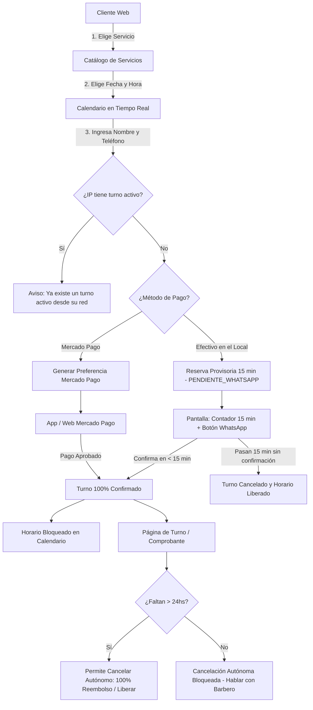

# Plan de Implementación: Web Peluquería (Fase 1: Turnos + Mercado Pago + Panel Barbero)

## Descripción General
Desarrollar una aplicación web moderna, ágil y mobile-first para una peluquería/barbería enfocada en:
1. **Reservar turnos** sin necesidad de crearse una cuenta ni iniciar sesión para los clientes.
2. **Consultar disponibilidad en un calendario claro e intuitivo**: ver días y horarios libres; los turnos reservados se bloquean automáticamente en tiempo real.
3. **Elegir forma de pago**:
   - **Mercado Pago**: Redirección a la pasarela (Checkout Pro / App) y confirmación automática del turno al pagar.
   - **Efectivo en el local**: Reserva temporal que **requiere confirmación por WhatsApp dentro de los 15 minutos**. Si se confirma, pasa a 100% confirmado; si expiran los 15 minutos sin confirmación, el turno queda cancelado y se libera el horario en el calendario.
4. **Protección Anti-Spam Estricta**: Control estricto por **dirección IP** (máximo 1 turno activo/pendiente simultáneo por IP) además de registrar nombre y teléfono de contacto.
5. **Políticas de Cancelación (Autónoma vs Manual)**:
   - **Más de 24hs antes del turno**: El cliente puede cancelar de forma autónoma desde la web (en Efectivo se libera el horario; en Mercado Pago se realiza la devolución del 100% y se libera el horario).
   - **Menos de 24hs antes del turno**: **No se permite cancelación autónoma desde la web**. La cancelación y cualquier devolución parcial (50%) queda sujeta a la comunicación directa entre el cliente y el barbero (gestionable por el barbero desde su panel).
6. **Panel de Gestión para el Barbero**: Vista de agenda diaria/semanal protegida por PIN/contraseña, confirmación y rechazo de turnos de WhatsApp, cancelación y bloqueo manual de horarios. *(Nota: La venta de insumos queda diferida para la Fase 2)*.

---

## Decisiones Clave y Reglas de Negocio

> [!IMPORTANT]
> **Protección Anti-Spam por IP**:
> - Se registra la dirección IP del cliente al momento de solicitar el turno.
> - Se impide que una misma IP cree más de 1 turno pendiente o activo simultáneamente.

> [!IMPORTANT]
> **Flujo de Pago en Efectivo y Ventana de 15 Minutos**:
> - Al elegir **Efectivo en el local**, el turno NO se confirma inmediatamente.
> - Se reserva en estado `PENDIENTE_WHATSAPP` con una ventana de **15 minutos** (`expiresAt`).
> - La pantalla muestra una cuenta regresiva y un botón directo a WhatsApp con el mensaje pre-armado y código único de reserva (ej: `TURN-842`).
> - El cliente puede pulsar "Ya envié el mensaje de confirmación" y el barbero en su panel privado (`/admin`) valida o rechaza el turno en 1 clic.
> - Si pasan los 15 minutos sin confirmarse, el sistema cancela el turno automáticamente y el horario vuelve a quedar libre en el calendario.

> [!NOTE]
> **Políticas de Cancelación y Reembolsos**:
> - **Anticipación > 24 horas**:
>   - Cancelación autónoma permitida en la web a través del link de comprobante del cliente (`/turno/[codigo]`).
>   - **Efectivo**: Turno cancelado, horario liberado al instante.
>   - **Mercado Pago**: Turno cancelado, devolución automática del **100%** mediante API de Mercado Pago, horario liberado al instante.
> - **Anticipación < 24 horas**:
>   - **Bloqueada la cancelación autónoma** para el cliente en la web.
>   - Aparece mensaje explicativo informando que con menos de 24hs debe comunicarse directamente con el barbero vía WhatsApp.
>   - El barbero desde su panel privado podrá decidir si cancela el turno y si aplica el reembolso del 50% según lo acordado.

> [!TIP]
> **Fase 2 (Insumos y Productos)**:
> - Toda la lógica y UI de venta y catálogo de insumos se pospone para una segunda etapa, manteniendo el foco 100% en la experiencia de turnos y pagos.

---

## Diagrama de Flujo



---

## Modelo de Datos (Prisma / SQLite)

```prisma
// Configuración de la Peluquería / Horarios
model BusinessSetting {
  id               Int      @id @default(autoincrement())
  openingTime      String   @default("09:00") // Formato HH:mm
  closingTime      String   @default("20:00")
  slotDurationMin  Int      @default(30)      // Duración estándar del turno
  daysOpen         String   @default("1,2,3,4,5,6") // Lunes a Sábado
  salonPhone       String   @default("5491100000000") // WhatsApp del barbero
}

// Servicios (Corte, Barba, Combo, etc.)
model Service {
  id           Int           @id @default(autoincrement())
  name         String
  description  String?
  price        Float
  durationMin  Int           @default(30)
  active       Boolean       @default(true)
  appointments Appointment[]
}

// Turnos / Reservas
model Appointment {
  id             String    @id @default(cuid())
  code           String    @unique // Código amigable ej: TURN-842
  date           String    // YYYY-MM-DD
  startTime      String    // HH:mm
  endTime        String    // HH:mm
  clientName     String
  clientPhone    String
  clientIp       String    // Control estricto anti-spam por IP
  serviceId      Int
  service        Service   @relation(fields: [serviceId], references: [id])
  paymentMethod  String    // "EFECTIVO" | "MERCADOPAGO"
  status         String    @default("CONFIRMADO") // "PENDIENTE_WHATSAPP" | "CONFIRMADO" | "CANCELADO"
  expiresAt      DateTime? // Si es PENDIENTE_WHATSAPP, caduca a los 15 minutos
  
  // Datos de pago y reembolso Mercado Pago
  pricePaid      Float?    // Monto abonado
  mpPreferenceId String?
  mpPaymentId    String?
  refundStatus   String?   // "TOTAL" | "PARCIAL_50" | null
  refundAmount   Float?    // Monto devuelto
  refundId       String?   // ID de reembolso en Mercado Pago
  
  createdAt      DateTime  @default(now())
}
```

---

## Estructura de Archivos a Crear

### 1. Inicialización y Base de Datos
- `package.json`: Next.js 15, Prisma ORM, Tailwind CSS, Lucide React, date-fns, SDK `mercadopago`.
- `prisma/schema.prisma`: Esquema de datos para turnos, servicios y configuración del salón.
- `prisma/seed.ts`: Carga inicial con servicios estándar (Corte clásico, Corte + Barba, Perfilado de barba, etc.) y horarios.
- `.env`: Claves de Mercado Pago (`MP_ACCESS_TOKEN`), `NEXT_PUBLIC_APP_URL`, `ADMIN_PASSWORD` y teléfono del barbero.

### 2. Endpoints Backend (`src/app/api/`)
- `src/app/api/services/route.ts`: Listar servicios disponibles.
- `src/app/api/availability/route.ts`: Consultar disponibilidad horaria en tiempo real (excluye turnos confirmados y turnos provisionales de < 15 min; libera turnos de > 15 min expirados).
- `src/app/api/appointments/route.ts`:
  - `POST`: Crear turno validando límite estricto de IP.
    - Si es `EFECTIVO`: Crea con estado `PENDIENTE_WHATSAPP` y `expiresAt = now + 15 min`.
    - Si es `MERCADOPAGO`: Crea preferencia en Mercado Pago y retorna `init_point`.
  - `GET`: Obtener turnos para el panel del barbero.
- `src/app/api/appointments/[code]/route.ts`: Obtener datos del turno para el comprobante del cliente.
- `src/app/api/appointments/[code]/confirm/route.ts`: Confirmación del turno por WhatsApp.
- `src/app/api/appointments/[code]/cancel/route.ts`:
  - `POST`: Cancelación de turno:
    - Si es cliente autónomo: valida que falten **> 24 horas**.
    - Si faltan **< 24 horas**: devuelve error `400` impidiendo la cancelación autónoma.
    - Si es Mercado Pago y > 24hs: ejecuta reembolso del 100% en Mercado Pago y libera el turno.
- `src/app/api/mercadopago/webhook/route.ts`: Receptor de notificaciones de pago aprobado para pasar el turno a `CONFIRMADO` 100%.

### 3. Vistas de Usuario y Panel Barbero
- `src/app/page.tsx`: Página principal moderna, presentación de servicios y accesos a "Reservar Turno" y "Consultar mi Turno".
- `src/app/reservar/page.tsx`:
  - Selector de servicio.
  - Calendario y selector de hora en tiempo real.
  - Formulario de contacto (Nombre y Teléfono).
  - Selección de método de pago (Efectivo vs Mercado Pago).
  - Verificación anti-spam por IP.
- `src/app/reservar/confirmacion-efectivo/[code]/page.tsx`:
  - Vista exclusiva para pago en efectivo: Contador regresivo de 15 minutos en tiempo real.
  - Botón verde llamativo: *"Enviar WhatsApp al barbero para confirmar turno"*.
  - Botón de verificación y aviso de caducidad.
- `src/app/turno/[code]/page.tsx`:
  - Comprobante digital del turno.
  - Indicador de estado: Confirmado, Pendiente WhatsApp o Cancelado.
  - Botón "Cancelar Turno" visible **solo si faltan más de 24hs** con reembolso 100% si fue Mercado Pago.
  - Mensaje informativo si faltan menos de 24hs derivando al WhatsApp del barbero.
- `src/app/consultar-turno/page.tsx`:
  - Buscador de turnos por código o teléfono.
- `src/app/pago/exito/page.tsx` & `fallo/page.tsx`: Retorno de Mercado Pago.
- `src/app/admin/page.tsx`:
  - Panel privado del barbero protegido por clave.
  - Vista de agenda del día/semana.
  - Gestión de turnos pendientes de WhatsApp (Aceptar / Rechazar con 1 clic).
  - Cancelación de urgencia y bloqueo manual de horarios.

---

## Plan de Verificación

1. **Límite Anti-Spam por IP**:
   - Comprobar que no se permite crear más de un turno activo/pendiente simultáneo desde la misma IP.
2. **Ventana de 15 minutos en Efectivo**:
   - Verificar reserva provisional, contador regresivo, apertura de WhatsApp y liberación automática si expira.
3. **Cancelación autónoma > 24hs vs < 24hs**:
   - Comprobar que a >24hs se cancela y devuelve el 100% en Mercado Pago.
   - Comprobar que a <24hs la cancelación web está bloqueada y deriva al barbero.
4. **Mercado Pago Checkout**:
   - Verificar creación de preferencia y redirección fluida a Checkout Pro.
5. **Panel del Barbero**:
   - Verificar acceso seguro, aceptación de turnos en efectivo y control de horarios.
